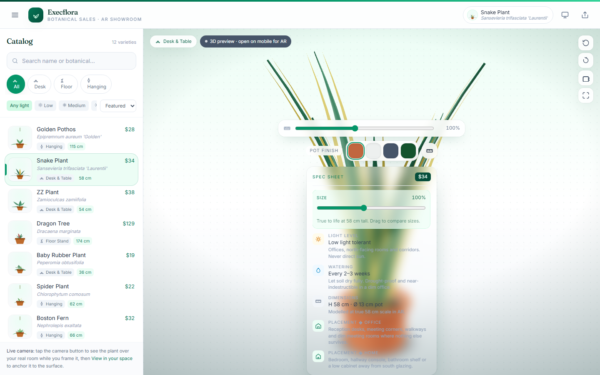

# Execflora — AR Plant Showroom



A single-file **WebXR augmented reality plant showroom** for botanical sales reps.
Execflora lets reps place true-scale indoor and outdoor plants onto a client's
desk, table or floor directly from a mobile browser — no app install required.

**Live demo:** <https://execflora-ar.vercel.app>

## Features

- **In-browser AR** via the Google `<model-viewer>` component with `webxr`,
  `scene-viewer` and `quick-look` modes (Android + iOS).
- **Catalog of 11 plant varieties** with descriptions, light needs and placement
  filters (All / Desk / Floor / Hanging).
- **Zero build step** — the entire experience is one self-contained `index.html`.
- Responsive, mobile-first UI styled with Tailwind CSS.

## Tech

`HTML` · `Tailwind CSS (CDN)` · [`<model-viewer>`](https://modelviewer.dev/) WebXR component

## Run locally

Open `index.html` in a browser, or serve the folder:

```bash
npx serve .
```

> AR modes require a supported mobile device and HTTPS (or localhost).
